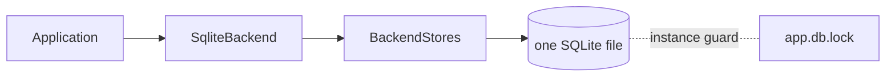

# StreamRune SQLite

The SQLite backend: StreamRune on one SQLite database file, for a small service that runs as one
instance. `SqliteBackend` opens every store of `streamrune-postgres` over a SQLite `DataSource`,
with the same contracts and the same contract suites.

## Overview

Everything StreamRune stores lives in one file next to the application: the event log and
snapshots, checkpoints, sagas, the outbox, the command inbox, the dead-letter queues, the audit
tables and the read models. One process owns the file, and one writer writes at a time.



The [SQLite guide](../docs/guide/sqlite.md) is the reference: when SQLite fits, the configuration on
Spring Boot, Quarkus, Micronaut and plain Java, and every place where it behaves differently from
PostgreSQL. This page lists what the module holds.

## Installation

```groovy
// build.gradle
implementation("org.streamrune:streamrune-sqlite:1.0.0")
```

```kotlin
// build.gradle.kts
implementation("org.streamrune:streamrune-sqlite:1.0.0")
```

> A release resolves from `mavenCentral()`; the [Status](../README.md#status) of the README says
> whether it is published yet. The unsigned preview of the next release has a version of its
> own and needs the Maven Central snapshot repository: see
> [Preview builds](../README.md#preview-builds). The [CHANGELOG](../CHANGELOG.md) says what
> each release contains.

The module brings the `org.xerial:sqlite-jdbc` driver, which bundles the SQLite library (3.45.0 or
newer is required and checked at startup), and Flyway for its schema series. It brings no
connection pool: the application owns the `DataSource`. The integrations do not depend on this
module; an application that sets `streamrune.backend=sqlite` adds it. Start the JVM with
`--enable-native-access=ALL-UNNAMED`: the driver loads a native library and the instance guard
calls `flock(2)` through the Foreign Function and Memory API.

## What the module holds

| Type | What it is |
|---|---|
| `SqliteBackend` | The `StreamRuneBackend` named `sqlite`: `verify(dataSource)` checks the connection settings, `open(context)` returns the `BackendStores` bundle. With `streamrune.backend=sqlite` the integrations load it by its class name. |
| `SqliteDatabase` | The handle on one database file: its startup checks, its instance guard, `migrate` and `validate` of a schema series. A read-model store on a second file opens its own. |
| `SqliteSchemaSeries` | The three schema series (event store, read models, crypto), each a Flyway baseline with its own history table. |
| `SqliteEventStore`, `SqliteEventStoreFactory` | The event store and snapshots, with the outbox, the command inbox and the audit entries written inside each append. |
| `SqliteOffsetStore`, `SqliteReadModelCheckpoints` | The subscription checkpoints and the read-model checkpoints, both fenced. |
| `SqliteProjectionRepository`, `SqliteReadModelStore` | Read models in `<name>_view` tables, with PostgreSQL's query results; the default read-model store named `sqlite`. |
| `SqliteSagaStore`, `SqliteSagaDeadLetterStore`, `SqliteConnectionFailures` | Saga state and saga dead letters, and the failures that tell the saga runner the database file is unusable. |
| `SqliteOutboxStore`, `SqliteCommandInbox` | The transactional outbox and the idempotency inbox. |
| `SqliteDeadLetterQueue`, `SqliteProjectionDeadLetterStore` | The command and the projection dead-letter stores. |
| `SqliteAuditStore`, `SqliteEventAuditStore`, `SqliteCommandAuditQuery`, `SqliteEventAuditQuery`, `SqliteComplianceReportQuery` | The audit trail and its queries. |
| `SqliteSnapshotStorePurger` | The GDPR purge of a subject's snapshots. |
| `SqliteGuardException` | The refusal of a file another process holds. |

An application takes the stores from the bundle; it constructs none of them by hand:

```java
BackendStores stores = new SqliteBackend().open(new BackendContext(
    pool, cryptoEngine, Clock.systemUTC(), StreamRuneMetrics.NOOP, StreamRuneTracing.NOOP,
    true,    // migrate the event-store (and crypto) series
    true,    // migrate the read-model series
    true));  // validate the schema
```

The guide's [Plain Java](../docs/guide/sqlite.md#plain-java) section continues from there to a
running command bus, a projection and a saga.

## What to know before choosing it

- **Connection settings are checked at startup.** `journal_mode=WAL`, `synchronous=FULL`,
  `foreign_keys=true`, a `busy_timeout` above 0 and `transaction_mode=IMMEDIATE`, on connections in
  autocommit mode; in-memory databases and attached databases are refused. See
  [Connection settings](../docs/guide/sqlite.md#connection-settings).
- **One process per file.** The handle holds an operating-system lock on `<file>.lock` until it is
  closed, and a second process is refused. See
  [One instance per database file](../docs/guide/sqlite.md#one-instance-per-database-file).
- **One write lock for the whole file.** Writes of every kind run one after another, and a writer
  waits at most `busy_timeout`. The stores' writers of one process queue for the lock in arrival
  order. See [One write lock for the whole file](../docs/guide/sqlite.md#one-write-lock-for-the-whole-file).
- **The stores never join an application's transaction** on the same file. See
  [Application transactions are never joined](../docs/guide/sqlite.md#application-transactions-are-never-joined).
- **No leadership, no `LISTEN`/`NOTIFY`, no statement timeout.** Projections and sagas poll.

## Related

- [`streamrune-sqlite-crypto`](../streamrune-crypto/streamrune-sqlite-crypto/README.md): the crypto
  engine with keys in the SQLite file.
- [`streamrune-postgres`](../streamrune-postgres/README.md): the PostgreSQL backend.
